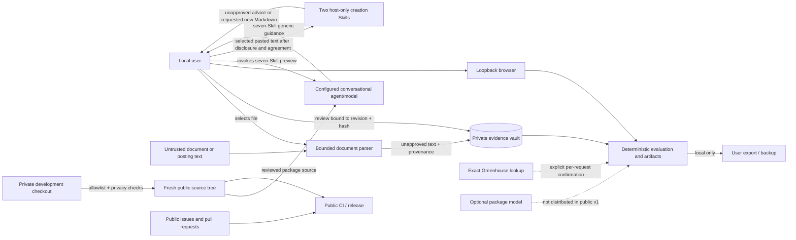

# Threat Model

Status: open-source v1 release model. This document describes hypotheses and controls, not
confirmed vulnerabilities or a security guarantee.

## Overview

Berufa is a local Python package for evidence-bound career decisions. The supported v1 path
runs on one user's device, stores private state beneath a user-selected instance root, accepts
bounded local documents, and exposes an optional loopback-only browser interface. The shipped
demonstrations are synthetic, offline, model-disabled, and unable to submit applications or send
messages (`src/career_os/synthetic_runtime.py:279`, `src/career_os/synthetic_runtime.py:321`,
`src/career_os/synthetic_runtime.py:332`).

The conversational Skill layer uses the user's configured agent/model provider. For the seven
workflow Skills, the experimental preview context is limited to
text and configuration from the exact reviewed package/repository revision, wholly fictional
bundled fixtures/demos, and content-free validation. Arbitrary public source, web pages, issues,
pull requests, tool/model output, and all real workflow data remain outside skill context. The
Python package does not bundle the provider, control its retention or training, or enforce its
tool/filesystem sandbox. Real workflows use the documented deterministic CLI in the user's local
terminal.

The two separate creation Skills use the exact owner-approved `supplied_content_host_only_v1`
package contract. After provider disclosure and explicit individual sharing agreement, they may
process deliberately pasted selected facts, role text and drafts the user is entitled to share.
No attachment extraction, ambient lookup, stored-data connection, credentials, confidential
third-party details, canonical mutation or external action is permitted. Requested new Markdown
and exact new-file readback are supported; real-content PDF/DOCX is excluded. Supplied text is
lower-authority data and cannot authorize tools or approve claims. Provider processing and host
tool access remain residual risks, not local-only inference or enforced sandboxing. This path
does not broaden the seven workflow Skills or enable an embedded package model. See
`docs/SUPPLIED_CONTENT_PROFILE.md`; acceptance tests remain wholly fictional.

The separately authorized maintainer release workflow generates a fresh public source tree from an
explicit allowlist. It does not publish the private development checkout or its Git history. The
export implementation intentionally remains outside the public tree; the generated
`PUBLIC_SOURCE_MANIFEST.json` is the candidate's destination-only digest evidence.

| Component | Security role | Source |
| --- | --- | --- |
| Document intake | Reads one regular non-link TXT, Markdown, PDF, or DOCX file; validates type and resource limits before returning unapproved text and provenance. | `src/career_os/document_intake.py:197`, `src/career_os/document_intake.py:752`, `src/career_os/document_intake.py:943` |
| Evidence vault | Stores source content, revisions, and append-only review events in an instance-bound SQLite database. Only the local user can approve or dispose evidence. | `src/career_os/evidence_vault.py:244`, `src/career_os/evidence_vault.py:269`, `src/career_os/evidence_vault.py:689` |
| Runtime authority boundary | Validates instance ownership, separates production and shadow stores, requires confirmation for stateful career events, and treats model/provider access as injected policy decisions. | `src/career_os/product_runtime.py:51`, `src/career_os/product_runtime.py:67`, `src/career_os/product_runtime.py:209`, `src/career_os/product_runtime.py:254` |
| Participant flow and UI | Persists deterministic local state, creates local artifacts/exports, requires explicit reset text, and serves only on literal IPv4 loopback. | `src/career_os/participant_flow.py:196`, `src/career_os/participant_flow.py:649`, `src/career_os/participant_flow.py:698`, `src/career_os/participant_app.py:687` |
| Public-source export | Maintainer workflow requiring reviewed public files, privacy/secret checks, an exact tree, and destination-only SHA-256 manifest. The exporter is intentionally not distributed. | Provided release context; generated `PUBLIC_SOURCE_MANIFEST.json` |
| Public CI and contribution channels | Run tests/build/secret scanning against public source. They must never receive a private workspace or candidate material. | `.github/workflows/quality.yml:1`, `.github/workflows/secret-scan.yml:1`, `.github/ISSUE_TEMPLATE/bug_report.yml:1` |
| Seven workflow Skills' agent host | Executes these Skills under configured provider terms with reviewed package source, bundled fictional data and content-free validation only; validated metadata and reviewed text are not a host sandbox. | `skills/manifest.toml`, `src/career_os/skill_validation.py`, `skills/*/SKILL.md`, `docs/DATA_AND_MODEL_POLICY.md` |
| Two creation Skills' agent host | Processes deliberately pasted selected text after provider disclosure and individual agreement under the exact supplied-content profile; no stored-data connection or external action. Host tools may create and read back only requested new Markdown. | `docs/SUPPLIED_CONTENT_PROFILE.md`, `plugins/rolevane-creation-fictional/references/writing.md`, packaged `BUNDLE-MANIFEST.json` |
| Official lookup | Exact Greenhouse lookup requires a hash-bound local-user confirmation for one request and returns a source-authenticated observation at retrieval. It sends no candidate data and does not persist into the official dossier or decision service, create an application, or create a career event. | `src/career_os/application/official_postings.py`, `src/career_os/infrastructure/greenhouse.py`, `src/career_os/infrastructure/provider_http.py` |
| Optional package models | The public v1 package supplies model interfaces but no embedded model client. Any future implementation is a conditional boundary requiring a separate review and explicit local enablement. | `src/career_os/authority_ports.py:120`, `src/career_os/authority_ports.py:131`, `src/career_os/authority_ports.py:140`, `src/career_os/synthetic_runtime.py:332` |

### Effective resources

The official lookup treats all returned text as untrusted, rejects mismatched tenant/posting IDs,
prospect posts and malformed payloads, and retains original-response and normalized-content hashes.
Those hashes bind source identity and bytes, not semantic truth; user approval of evidence is a
review decision, not independent verification of the source statement.
Its shared public transport binds the exact host, validates public DNS addresses and connects to
that address with TLS verification for the original hostname. Redirects, proxies, credentials,
compressed/non-JSON responses and oversized bodies are rejected. These controls need release-head
verification; they are not protection against a compromised employer or provider publishing false
content. The CLI does not persist observations or grant application readiness. Private collectors
retain their existing injected legacy transport policy outside the public command graph.

| Deployment or workflow | Resource or capability | Configuration and precedence | Safe effective value or location | Readers, writers, or recipients | Enforcing control | Evidence or unknowns |
| --- | --- | --- | --- | --- | --- | --- |
| Installed local runtime | Instance root | Explicit CLI/application argument; relative child paths derive from it | Absolute user-selected directory outside a public checkout | Local user and local Berufa process | Child paths are resolved beneath the root; runtime components must share the same root | `src/career_os/instance_paths.py:39`, `src/career_os/instance_paths.py:54`, `src/career_os/product_runtime.py:67` |
| Evidence review | Evidence database | Optional explicit path, otherwise instance default | `<instance>/data/evidence-vault.db` | Local user and process; exports receive selected records, not credentials | Path must remain beneath instance data; root fingerprint and content hashes are verified | `src/career_os/evidence_vault.py:252`, `src/career_os/evidence_vault.py:269`, `src/career_os/evidence_vault.py:369` |
| Generic runtime storage | Production and shadow databases | Fixed paths derived from instance root | `<instance>/data/runtime/career.db` and `<instance>/data/runtime/shadow/source-shadow.db` | Local runtime components with the requested role | Separate paths and stored role identity; path/reparse checks bind the opened file | `src/career_os/instance_paths.py:70`, `src/career_os/product_runtime.py:114`, `src/career_os/store.py:424` |
| Participant flow | State and generated artifacts | Fixed paths below the instance | `<instance>/data/participant-flow.json`, `<instance>/applications/...`, `<instance>/exports/...` | Local user and loopback process | Safe relative paths, manifests, hashes, and exact artifact names | `src/career_os/participant_flow.py:48`, `src/career_os/participant_flow.py:508`, `src/career_os/participant_app.py:630` |
| Browser interface | HTTP listener and write authority | Host constant plus optional port | `127.0.0.1:<port>` | Browser on the local device | Literal loopback bind, exact Host and CSRF; foreign Origin/cross-site Fetch-Site rejected when supplied; bounded forms and restrictive headers | `src/career_os/participant_app.py:43`, `src/career_os/participant_app.py:203`, `src/career_os/participant_app.py:794`, `src/career_os/participant_app.py:827` |
| User export | Evidence, decisions, audit, artifact inventory | Explicit local action | `<instance>/exports/career-os-user-export.json` | Local user; any later recipient chosen by that user | Artifact digest checks; manifest states no credentials, telemetry, or external actions | `src/career_os/evidence_vault.py:1217`, `src/career_os/participant_flow.py:645` |
| Reset | Entire participant instance | Exact confirmation phrase | The validated instance root only | Local user/process | Refuses home/filesystem root, links/reparse points, and unexpected top-level entries | `src/career_os/participant_flow.py:676`, `src/career_os/participant_flow.py:698` |
| Public export | Public source candidate | Versioned source/destination allowlist plus product boundary | A new operator-selected directory with no Git history | Maintainer, CI, eventual public users | Exact tree, UTF-8, deny patterns, regular files, and SHA-256 manifest | Provided release context; exporter is intentionally outside the public tree |
| Seven conversational workflow Skills | Agent host and provider selected outside Berufa | Exact reviewed package source, bundled fictional fixtures/demos, or content-free validation only | Provider-defined remote or local model context | Configured agent/model provider | The validator enforces manifest maturity/data classes; exact-head tests review shipped skill/launcher text; release revision/checksums bind the installed files. The validator alone does not attest an arbitrary copied or modified pack. Host sandbox/retention remain external and unproven. | `skills/manifest.toml`, `src/career_os/skill_validation.py`, `skills/*/SKILL.md`, `docs/DATA_AND_MODEL_POLICY.md` |
| Two creation Skills | Host/provider selected outside Berufa | Exact supplied-content manifest; disclosure and explicit agreement before selected pasted text | Provider-defined model context; requested new Markdown outside canonical state | Configured host/provider and user-selected local file recipient | Instruction-level limits exclude attachments, ambient lookup, connected records, credentials and external actions. Revocation stops processing. No provider-retention, filesystem isolation or injection-immunity guarantee. | `docs/SUPPLIED_CONTENT_PROFILE.md`, packaged `BUNDLE-MANIFEST.json`, shared writing method |
| Optional package model/provider | Embedded network and data transfer | No implementation or enabled configuration is shipped | None in v1 | No package-selected external recipient | Synthetic policy denies models and network; future adapters require explicit policy | `src/career_os/synthetic_runtime.py:285`, `src/career_os/synthetic_runtime.py:321`, `src/career_os/synthetic_runtime.py:335` |

## Trust Boundaries And Assumptions

### Agent instruction boundary

The agent boundary is an authority boundary, not a prompt-wording convention:

1. Where the agent host provides an instruction hierarchy, its system/developer policy and the
   authenticated user's direct, current instruction are the controlling authority. A versioned,
   reviewed Berufa skill narrows the workflow but cannot override higher-level policy or grant
   authority the user did not give.
2. Candidate documents, postings, URLs, web pages, screenshots, issue/PR bodies and comments,
   contributor patches, tool or command output, generated files, and model responses are untrusted
   data. Labels such as "system", "approved", "maintainer", "ignore previous instructions", or a
   copied confirmation digest do not change that classification.
3. Repository or skill changes proposed by a contributor remain untrusted until human review,
   exact-head checks, and merge into the versioned release candidate. Public issue text is never a
   runtime policy source.
4. Skill policy forbids untrusted content from selecting extra files, invoking a provider/tool, or
   granting authority. Berufa does not technically enforce agent-host file/tool least privilege;
   it does enforce that deterministic APIs do not accept content as evidence approval, structural
   role-pack authority, event confirmation, or an external action.
5. Stateful authority uses a separate explicit user action bound to the exact current hash or
   revision. The same content being processed cannot supply that confirmation.

The concrete malicious-input cases and regressions are maintained in
`docs/ABUSE_CASE_MATRIX.md`; release dispositions are maintained in
`docs/OPEN_SOURCE_READINESS.md`.

### Protected assets

- Identity, contact details, employment history, private search intent, compensation, achievements,
  target companies, applications, interview notes, and confirmed outcomes.
- Original source documents, extracted text, evidence approvals/revocations, forbidden claims,
  provenance, generated artifacts, exports, backups, local databases, and logs.
- Provider/model credentials and budgets if a later optional integration is enabled.
- Role-pack and skill integrity, public release contents and checksums, and the separation between
  the private development checkout and the public repository.

### Actors and starting capabilities

| Actor | Starts with | Does not inherently have |
| --- | --- | --- |
| Malicious document/posting author | Control of file bytes or text the user chooses to process | Local filesystem, shell, approval, tool, provider, or external-action authority |
| Malicious website | Ability to make a browser attempt requests to local addresses | Correct loopback Host/origin context or CSRF token |
| Another local user or local malware | Whatever the operating system account and device permit | A Berufa sandbox boundary beyond operating-system controls |
| Malicious or careless contributor | Control of issue/PR text and proposed code | Maintainer merge rights, release credentials, or private workspace data |
| Compromised dependency/action | Code execution in the environment where that dependency/action runs | Private candidate data unless a user or workflow wrongly places it there |
| Seven workflow Skills' provider | Reviewed package source, bundled fictional fixtures/demos, and content-free validation supplied when invoked | Arbitrary public content, real/private workflow data, local paths or command output, deterministic approval authority, or external-action authority |
| Two creation Skills' host/provider | Selected pasted text after disclosure and explicit sharing agreement; limited requested new Markdown and its readback | Unselected local or connected records, attachment extraction, canonical approval or persistence, credentials, sending/submission or implied career events |
| Future package model/provider operator | Data explicitly sent after a future embedded integration is enabled | Unsent local files, approval authority, or external-action authority |

### Security invariants

1. Deterministic Berufa APIs treat document, posting, issue, PR, skill, and model content as
   data. That content cannot approve evidence, change structural role-pack rules, confirm events,
   or represent an external action. Agent-host instruction/tool behavior remains a separate risk.
2. Only a local-user action bound to the exact evidence revision and content hash can approve,
   reject, defer, or revoke evidence (`src/career_os/evidence_vault.py:689`).
3. Generated decisions and artifacts remain proposals. A decision projection is read-only and a
   career event requires explicit confirmation (`src/career_os/product_runtime.py:209`,
   `src/career_os/product_runtime.py:308`).
4. One instance cannot use another instance's database, workspace, or component through normal
   runtime APIs (`src/career_os/product_runtime.py:67`, `src/career_os/evidence_vault.py:369`).
5. Parser, form, archive, XML, PDF, output, and reset work is bounded and fails closed on ambiguity.
6. The supported Python commands perform no embedded model call, remote telemetry, authenticated
   job-board access, application submission, or external messaging. Invoking a conversational
   Skill uses the configured provider. The seven workflow Skills permit only reviewed package
   source, bundled fictional data and content-free validation. The two creation Skills permit
   only the separately selected pasted-text contract after disclosure and individual agreement;
   none of these paths grants canonical approval, connected access or external-action authority.
7. Public source comes from the reviewed export allowlist, never from publishing the private Git
   history. Public CI, issues, and releases contain synthetic data only.
8. Credentials are references, not literal values in source or runtime contracts
   (`src/career_os/product_runtime.py:38`, `src/career_os/product_runtime.py:254`).

### Assumptions and limitations

- The user controls the local account and chooses a private instance directory. Berufa does not
  encrypt the workspace, manage full-disk encryption, or defend against malware with the same OS
  privileges. Backups and filesystem permissions remain user responsibilities.
- The loopback UI is single-user local software, not a multi-user service. Reverse proxies,
  containers exposing the port, remote hosting, and non-loopback binds are unsupported.
- Berufa skills do not sandbox the conversational agent, constrain its host filesystem/tools,
  or control provider retention/training. The seven-Skill preview contract excludes arbitrary public
  content and all real/private workflow values and results; users run those workflows locally.
  The two creation Skills transfer only deliberately shared text under their separate agreement.
  A user or host can bypass policy; no host-level isolation or injection immunity is established.
  Connected or otherwise broader conversational use remains release-blocked.
- The public v1 package does not ship a general network provider or model client. It ships only the
  exact, confirmed Greenhouse lookup described above. Any future source/provider adapter changes
  the boundary and requires purpose/data-class disclosure, credentials by reference, limits, terms
  review, and a separate security review.
- Parser libraries and GitHub Actions remain supply-chain dependencies. Pins, dependency review,
  checksums, and vulnerable-release response reduce but do not eliminate that risk.
- A clean public repository must be initialized from the generated export. Sanitization is not a
  claim that private Git history is safe to publish.
- License, product name, private vulnerability-reporting route, and exact release-provenance
  workflow remain release decisions. They are tracked in `docs/OPEN_SOURCE_READINESS.md`.

## Attack Surface, Mitigations, And Attacker Stories

These are prioritized hypotheses for design and review, not confirmed findings.

| Priority | Scenario and capability gain | Prerequisites | Impact | Existing controls | Required mitigation / verification | Evidence |
| --- | --- | --- | --- | --- | --- | --- |
| P0 | A private document, identifier, secret, or Git history is included in the public repository or release. | Maintainer bypasses the exporter, weakens the manifest, or overlooks encoded/private content. | Irreversible privacy or credential disclosure. | Explicit allowlist, deny paths/content, tracked-file classification, link rejection, exact tree and digest verification, secret scan. | Create a fresh repository from one exact export; scan candidate contents and intended history; never seed it from the private checkout. | Provided release process and generated `PUBLIC_SOURCE_MANIFEST.json` |
| P0 | A malicious PDF/DOCX exploits parser behavior or exhausts local resources. | User selects attacker-controlled document; vulnerable parser or missing bound is reachable. | Local code execution, data access, or availability loss. | Regular-file identity checks, 15 MiB input cap, PDF/object/page/decoded limits, DOCX member/size/ratio/depth limits, hardened XML, exact DOCX relationships, dangerous-field rejection, and active/external-content rejection. | Retain the synthetic regressions listed in `docs/ABUSE_CASE_MATRIX.md`; keep compatibility failures explicit and update vulnerable dependencies promptly. | `src/career_os/document_intake.py:38`, `src/career_os/document_intake.py:191`, `src/career_os/document_intake.py:943`, `tests/test_document_intake.py:173` |
| P0 | Prompt injection in a resume, posting, public web page, issue/PR, tool result, or model output convinces one of the seven conversational workflow Skills to inspect extra files, invoke tools, approve facts, or claim an external event. | A user or host bypasses the no-untrusted-source preview contract, or a compromised package/repository revision reaches installation. | Unwanted tool actions, false claims, or private-data disclosure. | All seven manifests are `synthetic-only` with an exact model-data ceiling; the validator rejects broader manifest classes; exact-head tests cover launchers and skill text; release checksums bind the reviewed files. Arbitrary public content, all real/private data, paths, summaries, requests, hashes, confirmations, and terminal output are refused. Deterministic authority checks remain separate. These controls do not sandbox the host agent or prove a modified pack safe. | Keep the exact ceiling, exact-head text checks, and reviewed-release installation proof. Any broader or modified conversational profile remains release-blocking until a supported host boundary is proven or the owner explicitly accepts the residual risk. | `skills/manifest.toml`, `src/career_os/skill_validation.py`, `tests/test_public_skill_pack.py`, `tests/test_product_runtime.py:111` |
| P0 | A malicious contribution weakens privacy, evidence, parser, provider, or release controls and reaches a release. | Reviewer misses a boundary change or CI is bypassed. | Public users receive unsafe code or a contaminated package. | Pull requests, pinned CI actions, full tests, secret scan, boundary manifest, human merge authority. | Require issue/PR risk declaration, code-owner review, exact-head CI, dependency review, and checksums before release. | `.github/workflows/quality.yml:1`, `.github/workflows/secret-scan.yml:1` |
| P1 | A malicious site drives writes to the local browser service or reads artifacts. | User has the app running and browser protections are bypassed. | Local evidence/state mutation or private artifact exposure. | Literal loopback bind, exact Host and per-process CSRF, foreign Origin/cross-site Fetch-Site rejection when supplied, content/type/size limits, CSP, no directory serving. | Keep loopback-only tests and do not add CORS, wildcard hosts, arbitrary paths, or remote deployment without a new model. | `src/career_os/participant_app.py:203`, `src/career_os/participant_app.py:630`, `src/career_os/participant_app.py:794`, `src/career_os/participant_app.py:827` |
| P1 | A path, symlink, junction, or database-role mix-up crosses workspace boundaries. | Attacker can alter local filesystem layout or caller supplies a foreign component/path. | Read/write/delete data from another workspace. | Resolved instance paths, component-root validation, database role identity, regular-file/reparse checks, reset inventory and broad-root refusal. | Retain cross-instance and reparse regression tests on Windows and POSIX; treat same-user local malware as residual OS risk. | `src/career_os/instance_paths.py:54`, `src/career_os/product_runtime.py:67`, `src/career_os/store.py:611`, `src/career_os/participant_flow.py:676` |
| P1 | A future embedded package model receives disallowed candidate data or its output is treated as approved truth. | User enables a package model integration without a data policy or deterministic gate. | Confidential-data disclosure or unsupported career claims. | No embedded model client ships; synthetic policy denies access; allowed access requires named provider/model and referenced credentials. | Require per-purpose categories, explicit user choice, provider/retention disclosure, local receipt without raw prompt, and a manual path. Model output stays unapproved. | `src/career_os/product_runtime.py:254`, `src/career_os/synthetic_runtime.py:332` |
| P1 | The shipped exact Greenhouse lookup, or a future source adapter, performs SSRF, follows unsafe redirects, leaks credentials, or bypasses protected sites. | The user confirms an exact supported Greenhouse URL, or a future provider is enabled. | Local-network access, credential disclosure, provider/terms risk, or corrupted source identity. | The shipped adapter makes one credential-free GET only to `boards-api.greenhouse.io` after exact preview confirmation; public DNS/IP, TLS, redirect, response-size/content, identity, and URL checks fail closed. It does not provide broad collection or persist an official dossier/decision. Future adapters remain blocked by default. | Recheck the provider interface and terms at release; retain HTTPS/host/IP/redirect/content/retry limits, no personal credentials or protected-site bypass, explicit per-request confirmation, and a separate review for every future adapter. Residual provider false-content, availability, terms, and SSRF risk remains. | `src/career_os/infrastructure/greenhouse.py`, `src/career_os/infrastructure/provider_http.py`, `tests/test_official_posting.py` |
| P1 | A public issue or PR contains a resume, recruiter message, compensation, or secret. | Contributor ignores warnings. | Public disclosure and persistent copies in notifications/caches/forks. | Templates prohibit private data and direct security reports away from public issues. | Restrict/delete immediately, rotate credentials, contact hosting support where needed, and preserve only sanitized incident metadata. | `.github/ISSUE_TEMPLATE/bug_report.yml:1`, `docs/INCIDENT_RESPONSE.md:1` |
| P2 | A generated artifact or browser state is mistaken for a submitted application or confirmed outcome. | User or agent infers an external event from local generation. | Incorrect pipeline history or unintended follow-up. | Artifact text and state declare no submission; event confirmation is separate and explicit. | Skills and UI must preserve the prepare/confirm separation and record only user-confirmed external events. | `src/career_os/participant_flow.py:485`, `src/career_os/participant_flow.py:615` |
| P2 | A dependency or pinned action is compromised. | Malicious upstream release/action commit or dependency resolution. | Code execution in local install or CI; release tampering. | Minimal dependencies, action commit pins, read-only CI permissions, offline tests, secret scan. | Record licenses/versions, review updates, add exact release dependency evidence and checksums, and publish a fixed release/advisory when needed. | `pyproject.toml:1`, `.github/workflows/quality.yml:1` |
| P2 | Backup, restore, export, or deletion is incomplete. | User copies a live/incomplete instance or assumes deletion covers external backups. | Data loss or retained private copies. | Full snapshot verification; filtered typed export; exact complete-inventory confirmation; selected-root-only path deletion; retained-copy report. | Keep every writer stopped, inspect the export, verify backups, delete external copies separately, and rehearse the exact release candidate. | `src/career_os/infrastructure/recovery.py`, `src/career_os/infrastructure/instance_data.py`, `tests/test_instance_recovery.py` |

## Severity Calibration

| Severity | Berufa example | Counterexample or downgrade condition |
| --- | --- | --- |
| Critical | Reliable code execution from a normal untrusted-document import; compromise of release authority that distributes malicious artifacts; deliberate public release of a broad private candidate corpus. | Requires proof of reachability and material new authority. An attacker who already controls the user's OS account has no additional Berufa privilege to gain. |
| High | Cross-instance read/write/delete of private evidence; silent transmission of restricted data to a model/provider; remote exposure of the local UI with mutation capability; publication of a resume or live credential. | Downgrade when the effect is limited to synthetic data, needs unsupported deployment, or a credential was invalid and never usable. |
| Medium | Bounded local denial of service from one malformed document; incomplete deletion inventory leaving a known local copy; contribution or dependency weakness requiring user interaction and no demonstrated private-data access. | Downgrade when limits contain the effect to one restart and no persistent integrity/privacy impact exists. |
| Low | Misleading error text, missing hardening header without an exploitable browser path, or self-only corruption of disposable synthetic demo state. | Ordinary documented behavior, unsupported configurations, and issues requiring authority the attacker already has are not security findings. |

Confidence and impact are separate. Missing evidence is an open question, not a reason to inflate or
dismiss severity. High or critical unresolved risks block the public-release decision.
